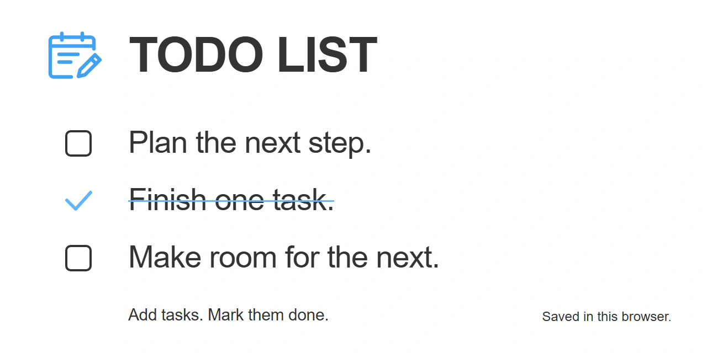
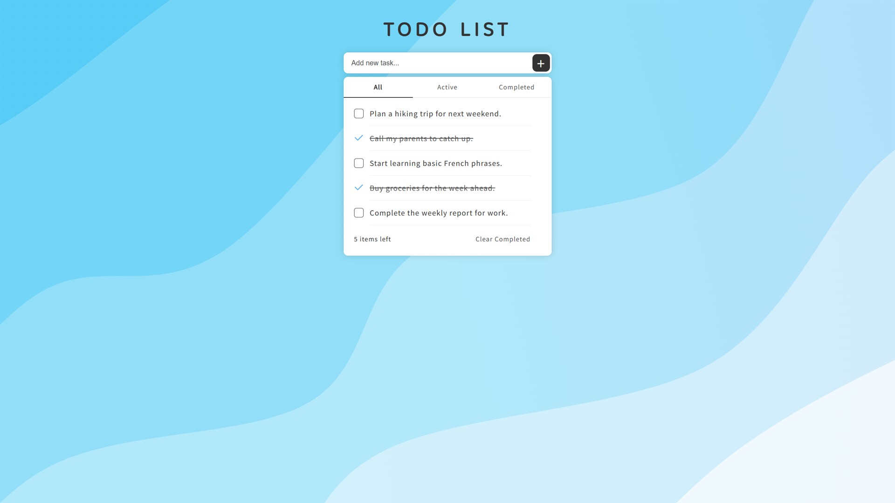

# Todo List



Todo List is a browser-based task manager built with React 18 and TypeScript. It stores tasks in the browser's local storage, so task text and completion states persist across page reloads without a backend.

## Features

- Add tasks with the `+` button.
- Mark individual tasks as active or completed.
- Delete tasks with the cross button.
- Filter the list by `All`, `Active`, or `Completed`.
- Remove all completed tasks at once.
- Keep task data in browser local storage.
- Adapt the layout for desktop and mobile screens.

## Demo

[](https://sky9154.com/github/Todo-List/)

## Setup and run

Run the following commands from the repository root:

```bash
yarn install
yarn dev
```

The development server prints its address when it starts.

## Usage

1. Enter a task in the text field.
2. Select the `+` button to add it to the beginning of the list.
3. Select a task row or its checkbox to change its completion state.
4. Use `All`, `Active`, or `Completed` to filter the visible tasks.
5. Select the cross button to delete one task.
6. Select `Clear Completed` to remove every completed task.

Pressing Enter does not add a task in the current implementation.

## Project commands

| Command | Purpose |
| --- | --- |
| `yarn dev` | Start the webpack development server |
| `yarn build` | Generate static files in `build/` |
| `yarn prettier` | Format files under `src/` |

## Data storage

Tasks are stored in `localStorage` under the `todoData` key as a JSON array. Each item contains:

```ts
{
  text: string;
  id: number;
  checked: boolean;
}
```

The data belongs to the current browser profile. It is not synchronized between browsers or devices, and clearing the site's browser data removes the stored tasks.

## Third-party material

The interface loads `Baloo Tamma 2` and `Noto Sans TC` from Google Fonts. Their licenses apply separately from this project's MIT License.

## License

This project is licensed under the MIT License. See [LICENSE](LICENSE) for details.